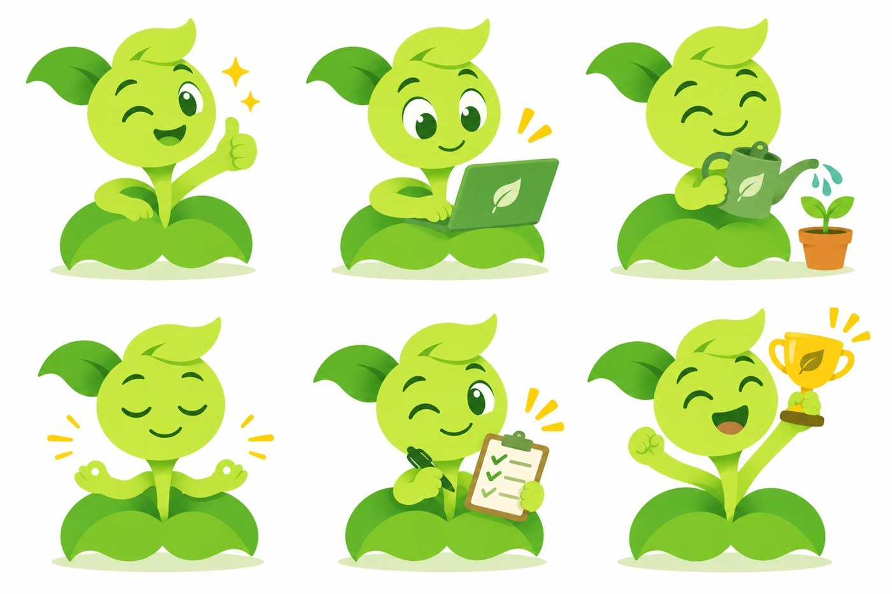
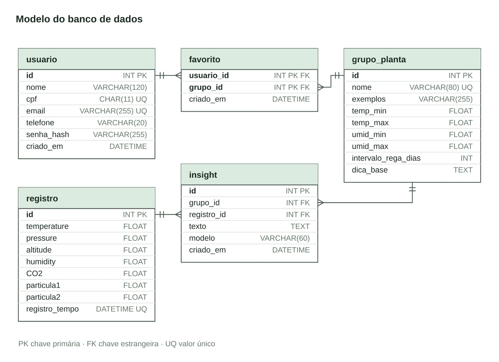

# BemPlantado. — Documentação do projeto

Projeto Integrador · Monitoramento Ambiental · Ciência de Dados

**Integrantes**

- Arthur Buscarino Benedetti
- Bruno Pezzolato Hollosi
- Fabio Henrique Lourenço Pacheco
- Guilherme Ribeiro Rocco
- Thayna Assis da Costa

---

## 1. Descrição do Projeto

### 1.1 Objetivo

**Objetivo geral:** desenvolver uma plataforma web que acompanha a temperatura e a umidade do local onde as plantas são cultivadas e, com base nos **grupos de plantas** e na previsão do tempo, orienta o usuário de forma simples e visual sobre as condições do ambiente e sobre o momento de regar.

**Objetivos específicos**

- Receber, validar e armazenar em banco de dados as medições de um sensor IoT enviadas por MQTT.
- Disponibilizar os dados por uma API própria, que alimenta o painel (dashboard).
- Organizar as plantas em grupos de cultivo (cactos, suculentas, samambaias e outros), que definem os cuidados de referência.
- Apresentar leitura atual, histórico e indicadores visuais de atenção em uma interface simples.
- Integrar serviços externos de previsão do tempo, informações botânicas e identificação de plantas.

### 1.2 APIs utilizadas

O painel obtém todos os dados pela API própria, nunca diretamente do banco. As chaves dos serviços externos ficam no servidor, em variáveis de ambiente.

| API | Para que serve | Acesso |
|---|---|---|
| **Open-Meteo** | Previsão do tempo dos próximos 7 dias (temperatura e chuva), usada para decidir o dia de regar | Sem chave; gratuito para uso não comercial |
| **Trefle** | Informações botânicas complementares de uma espécie, quando existem | Token de API |
| **Pl@ntNet** | Identificação da planta por foto (implementada; desativada na interface nesta fase) | Chave de API |
| **API própria (Flask)** | Entrega ao painel as leituras do sensor, os grupos, as plantas e a previsão | Rotas `/api/...` |
| **MQTT** | Recebe as medições do sensor (dados simulados nesta fase) | Broker MQTT |

### 1.3 Público-alvo

O projeto é direcionado a pessoas que cultivam plantas ornamentais em ambientes domésticos, especialmente iniciantes e entusiastas que desejam compreender melhor as condições ambientais adequadas ao cultivo.

O público contempla moradores de casas e apartamentos que mantêm plantas em espaços internos ou pequenas áreas residenciais e que podem apresentar dificuldades para identificar variações de temperatura e umidade, interpretar informações técnicas ou reconhecer condições ambientais que exigem atenção.

**Perfil e necessidades do público**

- **Ambiente de cultivo:** casas, apartamentos e pequenos espaços residenciais com necessidade de acompanhar as condições ambientais do local de cultivo.
- **Conhecimento:** usuários com diferentes níveis de experiência, especialmente aqueles com conhecimentos básicos sobre cultivo, que precisam compreender, de forma simples, informações sobre temperatura e umidade que impactam suas plantas.
- **Dificuldades:** identificar variações ambientais que possam comprometer as condições favoráveis às plantas, interpretar informações técnicas de forma simplificada e reconhecer condições que exigem atenção.
- **Necessidades:** acompanhar temperatura e umidade, compreender as condições do ambiente e receber informações claras para orientar decisões sobre o cultivo futuro ou em uma janela de tempo.

**O que essa abordagem acrescenta**

Ela permite justificar algumas decisões de desenvolvimento:

- **Interface simples:** porque o público não precisa ter conhecimentos técnicos.
- **Indicadores visuais:** porque os números isolados podem não ser suficientes para compreender as condições ambientais.
- **Histórico de medições e comparação:** porque permite acompanhar variações históricas e predições futuras, com base nos indicadores climáticos, tendo como principal base e foco a posição do dia.
- **Informações botânicas:** porque o usuário pode precisar de referências para interpretar os dados.

**Benefício esperado:** facilitar o acompanhamento das condições ambientais por meio de indicadores visuais e informações acessíveis, contribuindo para decisões mais conscientes sobre o ambiente em que as plantas são mantidas.

### 1.4 Parte da escola

A parte da escola será em **ambiente externo**, pois o teste do sistema precisa de plantas reais e de clima real, com variação de temperatura, umidade, sol e chuva.

---

## 2. Modelagem do Banco de Dados

### 2.1 Em palavras simples

O banco de dados é o "caderno" do sistema, onde as informações ficam guardadas. Ele é dividido em **tabelas**, e cada tabela guarda um tipo de informação, como uma planilha. As tabelas se ligam por um número de identificação (o `id`).

| Tabela | O que guarda | Exemplo |
|---|---|---|
| `registro` | Cada medição do sensor, com data e hora | 14h30: 24,2 °C e 58% de umidade |
| `grupo_planta` | Os 15 grupos de plantas e os valores ideais de cada um | Samambaias: regar a cada 3 dias |
| `usuario` | As pessoas que usam o sistema | Maria, com e-mail e senha protegida |
| `favorito` | Quais grupos cada pessoa acompanha | Maria acompanha "Samambaias" |
| `insight` | Um texto que explica o que uma medição significa para um grupo | "Está quente para as samambaias" |

Uma pessoa pode ter vários grupos favoritos, e um grupo pode ser favorito de várias pessoas: a tabela `favorito` faz essa ligação. Cada `insight` aponta para um grupo e para uma medição.

### 2.2 Diagrama

Os dados pessoais (CPF, e-mail e telefone) ficam na tabela `usuario`, sob a LGPD; a senha é guardada apenas como *hash*. No MVP 2 o banco (`banco/schema.sql`) já cria as cinco tabelas do modelo — `registro`, `grupo_planta`, `usuario`, `favorito` e `insight` — mais as de apoio (`grupo_exemplo`, `planta`, `rega`, `configuracao`). A aplicação usa hoje `registro`, `grupo_planta` e as de apoio; `usuario`, `favorito` e `insight` existem no banco, mas ainda não têm rotas na API.

### 2.3 Grupos de plantas

Os grupos organizam as plantas por características práticas de cultivo. **Não são categorias botânicas equivalentes**: uma planta pode integrar mais de um grupo, e cuidados específicos de uma espécie podem diferir dos do grupo.

| Grupo | Exemplos | Como reconhecer | Onde costumam ser cultivadas | Cuidados gerais |
|---|---|---|---|---|
| Cactos | Cacto-bola, cacto-orelha-de-coelho, cacto-macarrão | Muitos têm espinhos e caules grossos | Vasos, varandas ensolaradas e jardins | Preferem bastante luz e substrato drenante, e toleram ar seco |
| Suculentas | Rosa-de-pedra, planta-jade, babosa | Folhas ou caules grossinhos que armazenam água | Vasos pequenos, janelas iluminadas e varandas | Evitar excesso de água no substrato; luz conforme a espécie |
| Samambaias e avencas | Samambaia-americana, samambaia-paulista, avenca | Muitas folhas delicadas ou divididas | Interiores iluminados e varandas protegidas | Preferem umidade do ar mais elevada e proteção contra sol intenso |
| Orquídeas | Orquídea-borboleta, orquídea-chuva-de-ouro, orquídea-bambu | Flores características, frequentemente com raízes aéreas | Vasos, interiores iluminados e áreas protegidas | Iluminação, ventilação e rega variam conforme o tipo |
| Flores ornamentais | Rosa, violeta, begônia, margarida | Plantas cultivadas principalmente pelas flores | Vasos, janelas, varandas e jardins | Luz e regas adequadas à espécie; observar condições para floração |
| Folhagens ornamentais | Costela-de-adão, jiboia, comigo-ninguém-pode | Valorizadas por folhas grandes, coloridas ou desenhadas | Salas, quartos iluminados e varandas protegidas | Muitas preferem luz indireta e temperaturas moderadas a quentes |
| Plantas pendentes e trepadeiras | Jiboia, hera, colar-de-pérolas | Ramos caídos ou que se apoiam em estruturas | Vasos suspensos, prateleiras, muros e suportes | O cuidado depende da espécie; evitar generalizar a partir do crescimento |
| Arbustos ornamentais | Azaleia, hibisco, roseira | Vários galhos que formam uma planta encorpada | Jardins, quintais e vasos grandes | Geralmente precisam de espaço, luz e podas apropriadas |
| Árvores de pequeno porte | Ficus, pitangueira, jabuticabeira | Possuem tronco e copa, mesmo quando pequenas | Quintais, jardins e vasos grandes | Precisam de espaço para raízes e cuidados com luz, água e temperatura |
| Hortaliças | Alface, couve, rúcula, espinafre | Cultivadas para consumo das folhas ou outras partes | Hortas, jardineiras e canteiros | Necessitam de iluminação, água e temperaturas adequadas à cultura |
| Ervas aromáticas e temperos | Hortelã, alecrim, manjericão, salsinha | Folhas aromáticas utilizadas na culinária | Hortas domésticas, vasos e janelas | Necessidades bastante diferentes entre as espécies |
| Plantas frutíferas | Morangueiro, limoeiro, tomateiro | Produzem frutos utilizados na alimentação | Quintais, hortas e vasos adequados | Luz, água e temperatura influenciam crescimento e frutificação |
| Plantas com bulbos e estruturas de reserva | Amarílis, lírio, gladíolo | Algumas surgem de uma estrutura subterrânea que armazena nutrientes | Vasos, canteiros e jardins | Podem apresentar períodos de crescimento e repouso |
| Bromélias | Bromélia-imperial, gravatá, bromélia-guzmânia | Muitas apresentam folhas organizadas em roseta | Vasos, jardins tropicais e interiores iluminados | Cuidados com água, ventilação e luminosidade específicos de cada tipo |
| Plantas aquáticas | Aguapé, vitória-régia, alface-d'água | Vivem sobre ou dentro da água | Lagos, tanques e recipientes aquáticos | Necessitam de condições adequadas de água, luz e temperatura |
